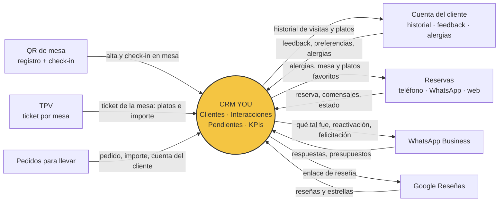

# CRM YOU

CRM para **YOU**, restaurante asiático familiar de Alcalá de Henares. Práctica individual de ESIC: diseñar, construir y publicar un CRM sencillo para un negocio pequeño dirigiendo a una IA.

Tiene dos partes:

- **CRM del restaurante** (para el personal): panel con KPIs, pendientes, clientes, ficha de cliente, mesas y presupuestos.
- **Cuenta del cliente** (móvil): el cliente escanea el QR de su mesa, se registra o hace check-in, ve su historial y valora cada visita.

## Rutas

| Ruta | Para qué |
| --- | --- |
| `/` | Panel: KPIs, lo más urgente y reservas de hoy |
| `/pendientes` | Pendientes ordenados por prioridad, con la regla de cortesía |
| `/clientes` y `/clientes/[id]` | Lista con segmentos y ficha con historial |
| `/mesas` | Mesas abiertas, check-ins, QR de cada mesa y cierre (simula el TPV) |
| `/presupuestos` | Celebraciones: enviado, ganado, perdido |
| `/mesa/[n]` | Destino del QR de la mesa n (cliente) |
| `/mi-cuenta` | Cuenta del cliente: historial, valoraciones y datos |

## Reglas principales

- **Segmentos** según la frecuencia de cada cliente (últimos 90 días): Diario (≤ 2 días), Semanal (≤ 9), Quincenal (≤ 16), Ocasional, Nuevo.
- **En riesgo** si lleva sin venir más de 7 / 21 / 35 días según su segmento.
- **9 tipos de pendiente** con prioridad: feedback negativo, alergia en mesa hoy, presupuesto sin respuesta (> 5 días), celebración próxima (≤ 3 días), habitual sin cuenta, te echamos de menos, cumpleaños (≤ 7 días), pedir reseña (feedback ≥ 4), preguntar qué tal fue.
- **Regla de cortesía**: máximo 1 mensaje comercial por cliente cada 14 días.
- Pedido para llevar de más de 60 € → aviso de botella de vino de regalo.

Toda la lógica está en `lib/reglas.ts`.

## Mapa de sistemas



## Datos

Los datos de ejemplo (clientes ficticios) se generan **relativos a la fecha de hoy**, así que la demo muestra los mismos pendientes cualquier día. Los cambios se guardan en el navegador (`localStorage`); el botón **Restablecer demo** vuelve al estado inicial. No hay integraciones reales con TPV, WhatsApp ni Google: se simulan.

## Ejecutar en local

```bash
npm install
npm run dev
```

## Publicar en Vercel

1. Sube este proyecto a un repositorio de GitHub.
2. En [vercel.com](https://vercel.com) → **Add New… → Project** → importa el repositorio.
3. Deja la configuración por defecto (Next.js) y pulsa **Deploy**. No necesita variables de entorno.
